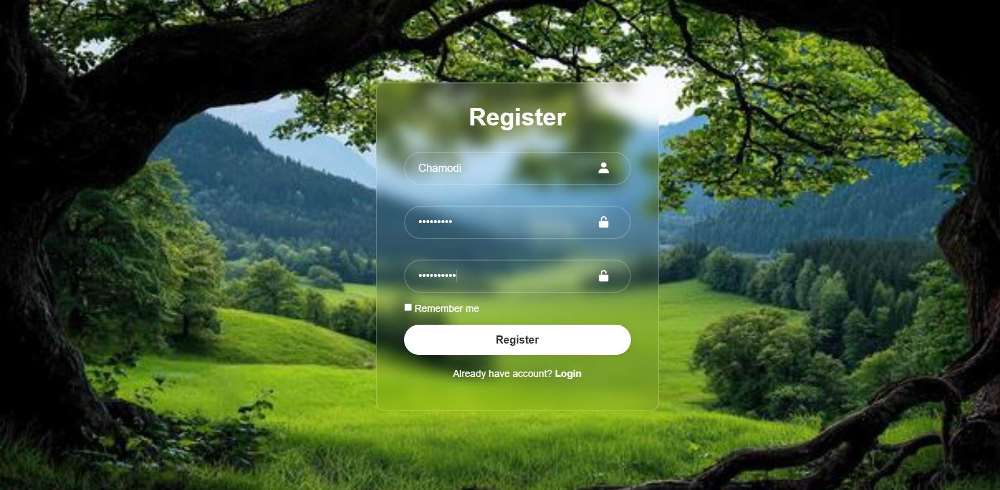

"# Login_Form" 
# Basic Login Form

A simple login form created to practice basic front-end web development.

## Features
- Username and password input fields
- Simple login interface
- Basic form validation

## Technologies Used
- HTML
- CSS
- JavaScript

## How to Run
1. Download or clone this project.
2. Open the project folder.
3. Open `index.html` in your web browser.
4. Enter the required details and try the login form.

## Screenshots

